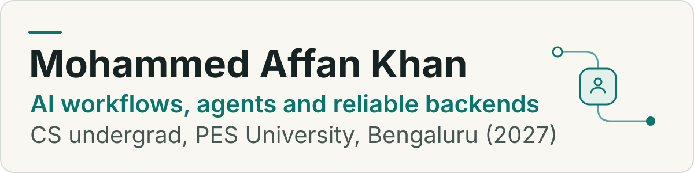
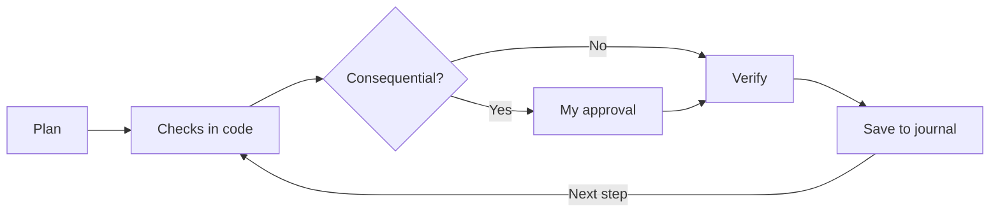

<picture>
  <source media="(prefers-color-scheme: dark)" srcset="./assets/banner-dark.svg">
  <source media="(prefers-color-scheme: light)" srcset="./assets/banner-light.svg">
  
</picture>

I build AI workflows and backend software with tests, human approval and safe defaults.

<strong>Open to:</strong> software engineering and applied AI internships and new-grad roles

  
  
  
  

## Private projects

The code is private, so this is what each project does. I'm happy to walk through the code or give a demo.

| Project | What it does | Status |
| --- | --- | --- |
| [**AI sales-enquiry workflow**](#ai-sales-enquiry-workflow) | Extracts requirements from customer messages for human approval | 🔒 Private, in development |
| [**Nova**](#nova) | Runs personal tasks locally with approval for consequential steps | 🔒 Private, active |
| [**Agent Hub**](#agent-hub) | Routes coding tasks between Claude Code and Codex | 🔒 Private, in daily use |
| [**IntelliHome**](#intellihome) | Turns a conversation into floor plans and 3D models | 🔒 Private, active |

### AI sales-enquiry workflow

  

Reads incoming customer messages, turns them into structured requirements, and hands off to a person for approval. Rules in code set prices, never the AI.

- A guard checks each AI reply, and a person approves before quotes are sent.
- Multi-tenant: database access rules keep each business's data separate.
- 764 automated tests, plus an evaluation set for the extraction.

**Stack:** Next.js, TypeScript, Supabase/Postgres, WhatsApp Cloud API, Claude API

### Nova

  

A local-first personal AI agent that plans and runs tasks step by step, keeps progress across restarts and asks for approval before anything consequential.

**My part:** I designed Nova's vision, roadmap, core architecture and security model, and built the original executor, approval journal, private-data routing and web-fetch tool. My collaborator designed and built later parts, including the background worker, structured records and idea tracking.

- 377 tests pass, including tests for the security checks. Nova has GitHub Actions CI and design decisions recorded as ADRs.
- Nova's own Python layer sits on the open-source [OpenJarvis](https://github.com/open-jarvis/OpenJarvis) framework, included in the repository.

No personal accounts are connected yet, and a full security audit comes before the first one.

**Stack:** Python, SQLite, Ollama

How Nova runs tasks and checks security

#### How a task runs

1. The local model proposes a plan limited to templates that trusted code defines.
2. The executor checks every step against the allowed tools, resources and budgets.
3. A consequential step pauses until I approve that exact action.
4. Each result is verified and saved to a journal before the next step starts.
5. I can preview a step before approving it, read a report of the task, cancel it or stop the whole service.

#### How the security checks work

- **Denied by default:** Code enforces the rules and refuses unknown tools and out-of-scope files.
- **Exact approvals:** Each approval is tied to a hash of the exact action, works once and expires after five minutes. If the action changes, the approval no longer applies.
- **Private data stays local:** Unlabelled data counts as private. The model can't relabel data, choose its own route or raise its budget.
- **Safe web reading:** HTTPS only. Nova blocks private network addresses on every DNS lookup and redirect, applies size and time limits, and never treats page text as instructions.
- **Crash safety:** Nova marks interrupted writes as uncertain and never repeats them automatically.
- **Credential checks:** Nova refuses to save text that looks like a password, key or token to memory.

### Agent Hub

  

Routes my development work between Claude Code and Codex and enforces the rules around it.

- Picks a route by task difficulty and an agent by remaining allowance, with cross-agent review before merging.
- A merge guard blocks merges with failing checks, open review threads or missing owner approval (221 test cases).
- An hourly, read-only inbox workflow finds deadlines and renewals, with checks that catch searches that fail silently.

**Stack:** Bash, Python, Next.js, Postgres, macOS launchd

### IntelliHome

  

Turns a conversation about requirements into rule-checked floor plans, drawings and 3D models. The private repository belongs to a teammate.

My work includes:

- Error handling and code-quality checks.
- The electrical and plumbing sheets.
- STL/GLB export.
- The chat-first frontend redesign.

**Stack:** Python, FastAPI, OR-Tools, Shapely, React

> The AI sales-enquiry workflow, Nova, Agent Hub and IntelliHome are built with AI coding agents (Claude Code and Codex).

---

## Public projects

| Project | What it is |
| --- | --- |
| [**ProConnect**](https://github.com/MohammedAffanKhan779/Professional-Networking) | LinkedIn-style platform: profiles, feed, connections with mutual suggestions, comments and likes, resume builder. MySQL triggers keep like and comment counts consistent. JWT auth. **Stack:** React, TypeScript, Vite, Tailwind, Node/Express, MySQL |
| [**Disaster Relief Management**](https://github.com/MohammedAffanKhan779/Disaster-Relief-Management-System) | Role-based relief operations: events, relief centers, resource allocation, donations, reports and dashboards, plus a REST API. CI builds on every push to main. **Stack:** Java 21, Spring Boot 3, JPA, Thymeleaf, MySQL, GitHub Actions |
| [**Jenkins + Docker load balancing**](https://github.com/MohammedAffanKhan779/PES2UG23CS343_Jenkins) | Jenkins pipeline that builds a Dockerized backend, runs two replicas and fronts them with an Nginx load balancer. **Stack:** Jenkins, Docker, Nginx |
| [**ROS2 fire-detection drone**](https://github.com/Shehzaad-khan/drone-fire-detection-ros2) *(team)* | Simulated patrol drone in Gazebo that detects fire and raises alerts. I wrote the initial OpenCV fire-detection node ([commit 7f76c39](https://github.com/Shehzaad-khan/drone-fire-detection-ros2/commit/7f76c39)), later refined by teammates. **Stack:** ROS2, Python, OpenCV |
| [**Kafka-style message broker**](https://github.com/NavneetNayak/90_Project2_BD) *(team)* | Leader/follower broker with producers and consumers. I wrote the producer. **Stack:** Python |

**Coursework:** [GenAI hands-on](https://github.com/MohammedAffanKhan779/GenAI_Handson) (LangChain, prompt engineering) · [ML labs](https://github.com/MohammedAffanKhan779/ML_F_PES2UG23CS343_Mohammed_Affan_Khan) (decision trees in scikit-learn and PyTorch) · [Cloud monolith lab](https://github.com/MohammedAffanKhan779/Cloud_Computing-MONOLITHIC-ARCHITECTURE) (Locust load tests)

---

## Stack

| Area | Tools |
| --- | --- |
| Languages | Python, TypeScript, JavaScript, Java, SQL |
| AI | Claude API, Ollama, LangChain, agent workflows, evaluation sets, scikit-learn, PyTorch, OpenCV |
| Backend | Node/Express, Spring Boot, FastAPI, Supabase/Postgres, MySQL |
| Frontend | React, Next.js, Vite, Tailwind |
| Infra | GitHub Actions, Docker, Jenkins, Nginx, Vercel, Linux |
