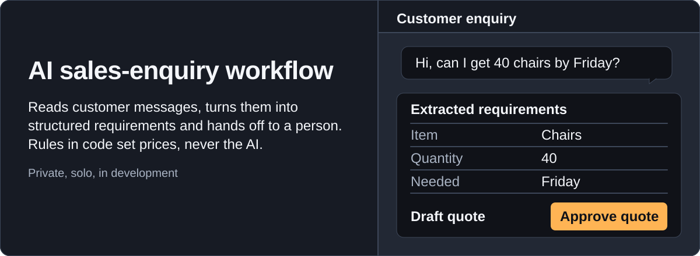
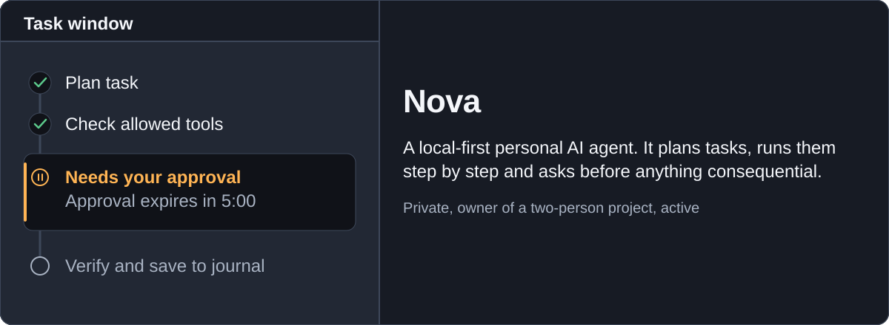
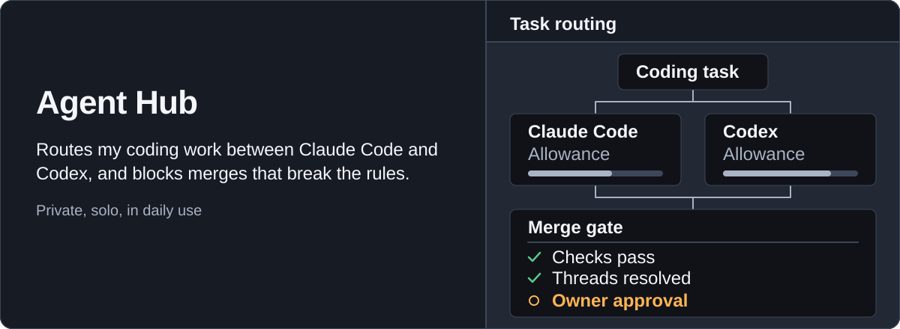
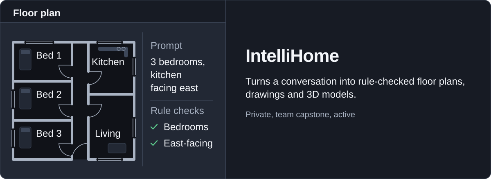

<picture>
  <source media="(max-width: 600px)" srcset="./assets/hero-mobile.svg">
  
</picture>

  <a href="https://mohammed-affan-khan.vercel.app/">Portfolio</a> · <a href="https://mohammed-affan-khan.vercel.app/resume">Resume</a> · <a href="https://www.linkedin.com/in/md-affan-khan-960783306/">LinkedIn</a> · <a href="mailto:mdaffankhan7910@gmail.com">Email</a>

Open to software engineering and applied AI internships and new-grad roles. CS undergrad at PES University, Bengaluru, graduating 2027.

## What I'm building

The code is private, and I'm happy to walk through it or give a demo. I build these projects with AI coding agents, Claude Code and Codex. Illustrations use sample data.

<picture id="ai-sales-enquiry-workflow">
  <source media="(max-width: 600px)" srcset="./assets/sales-workflow-mobile.svg">
  
</picture>

<b>AI sales-enquiry workflow</b>: how it works and my part

- A guard checks each AI reply, and a person approves before quotes are sent.
- Multi-tenant: database access rules keep each business's data separate.
- 764 automated tests, plus an evaluation set for the extraction.

**Stack:** Next.js, TypeScript, Supabase/Postgres, WhatsApp Cloud API, Claude API

 

<picture id="nova">
  <source media="(max-width: 600px)" srcset="./assets/nova-mobile.svg">
  
</picture>

<b>Nova</b>: how it works and my part

Nova keeps progress across restarts.

**My part:** I designed Nova's vision, roadmap, core architecture and security model, and built the original executor, approval journal, private-data routing and web-fetch tool. My collaborator designed and built later parts, including the background worker, structured records and idea tracking.

- 377 tests pass, including tests for the security checks. Nova has GitHub Actions CI and design decisions recorded as ADRs.
- Nova's own Python layer sits on the open-source [OpenJarvis](https://github.com/open-jarvis/OpenJarvis) framework, included in the repository.

No personal accounts are connected yet, and a full security audit comes before the first one.

**Stack:** Python, SQLite, Ollama

#### How a task runs

1. The local model proposes a plan limited to templates that trusted code defines.
2. The executor checks every step against the allowed tools, resources and budgets.
3. A consequential step pauses until I approve that exact action.
4. Each result is verified and saved to a journal before the next step starts.
5. I can preview a step before approving it, read a report of the task, cancel it or stop the whole service.

#### How the security checks work

- **Denied by default:** Code enforces the rules and refuses unknown tools and out-of-scope files.
- **Exact approvals:** Each approval is tied to a hash of the exact action, works once and expires after five minutes. If the action changes, the approval no longer applies.
- **Private data stays local:** Unlabelled data counts as private. The model can't relabel data, choose its own route or raise its budget.
- **Safe web reading:** HTTPS only. Nova blocks private network addresses on every DNS lookup and redirect, applies size and time limits, and never treats page text as instructions.
- **Crash safety:** Nova marks interrupted writes as uncertain and never repeats them automatically.
- **Credential checks:** Nova refuses to save text that looks like a password, key or token to memory.

 

<picture id="agent-hub">
  <source media="(max-width: 600px)" srcset="./assets/agent-hub-mobile.svg">
  
</picture>

<b>Agent Hub</b>: how it works and my part

- Picks a route by task difficulty and an agent by remaining allowance, with cross-agent review before merging.
- A merge guard blocks merges with failing checks, open review threads or missing owner approval (221 test cases).
- An hourly, read-only inbox workflow finds deadlines and renewals, with checks that catch searches that fail silently.

**Stack:** Bash, Python, Next.js, Postgres, macOS launchd

 

<picture id="intellihome">
  <source media="(max-width: 600px)" srcset="./assets/intellihome-mobile.svg">
  
</picture>

<b>IntelliHome</b>: how it works and my part

The private repository belongs to a teammate.

My work includes:

- Error handling and code-quality checks.
- The electrical and plumbing sheets.
- STL/GLB export.
- The chat-first frontend redesign.

**Stack:** Python, FastAPI, OR-Tools, Shapely, React

## Public work

[**ProConnect**](https://github.com/MohammedAffanKhan779/Professional-Networking) 
A LinkedIn-style platform with profiles, a feed, connections with mutual suggestions, comments, likes and a resume builder, with JWT auth and MySQL triggers that keep like and comment counts consistent. 
React, TypeScript, Vite, Tailwind, Node/Express, MySQL

[**Disaster Relief Management**](https://github.com/MohammedAffanKhan779/Disaster-Relief-Management-System) 
A role-based system for relief events, centers, resource allocation, donations, reports and dashboards, with a REST API and a CI build on every push to main. 
Java 21, Spring Boot 3, JPA, Thymeleaf, MySQL, GitHub Actions

[**Jenkins + Docker load balancing**](https://github.com/MohammedAffanKhan779/PES2UG23CS343_Jenkins) 
Jenkins pipeline that builds a Dockerized backend, runs two replicas and fronts them with an Nginx load balancer. 
Jenkins, Docker, Nginx

[**ROS2 fire-detection drone**](https://github.com/Shehzaad-khan/drone-fire-detection-ros2) *(team)* 
I wrote the initial OpenCV fire-detection node ([commit 7f76c39](https://github.com/Shehzaad-khan/drone-fire-detection-ros2/commit/7f76c39)), later refined by teammates, for a simulated patrol drone in Gazebo that detects fire and raises alerts. 
ROS2, Python, OpenCV

[**Kafka-style message broker**](https://github.com/NavneetNayak/90_Project2_BD) *(team)* 
I wrote the producer for this leader/follower broker with producers and consumers. 
Python

**Coursework:** [GenAI hands-on](https://github.com/MohammedAffanKhan779/GenAI_Handson) (LangChain, prompt engineering) · [ML labs](https://github.com/MohammedAffanKhan779/ML_F_PES2UG23CS343_Mohammed_Affan_Khan) (decision trees in scikit-learn and PyTorch) · [Cloud monolith lab](https://github.com/MohammedAffanKhan779/Cloud_Computing-MONOLITHIC-ARCHITECTURE) (Locust load tests)

## Stack

**Languages:** Python, TypeScript, JavaScript, Java, SQL 
**AI:** Claude API, Ollama, LangChain, agent workflows, evaluation sets, scikit-learn, PyTorch, OpenCV 
**Backend:** Node/Express, Spring Boot, FastAPI, Supabase/Postgres, MySQL 
**Frontend:** React, Next.js, Vite, Tailwind 
**Infra:** GitHub Actions, Docker, Jenkins, Nginx, Vercel, Linux
